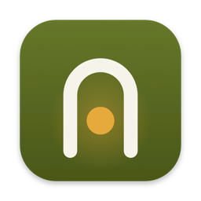

<h1 align="center">Seekers</h1>

<em>Seek, and you will find.</em>

Seekers is a free, self-paced study app for the Mac. Choose a program (General Biblical Studies,
Pastoral Care, Preaching and Teaching, Apologetics and Evangelism, or Worship Leader), set a start
date, and Seekers lays out your terms week by week: readings, lectures, Scripture, and assignments
with real due dates. The Berean Standard Bible is built in.

Everything stays on your Mac. There's no account, no sign-in and no tracking.

## Download

**[Download the newest version](https://github.com/b-frazier/seekers/releases/latest)**: under
*Assets*, click `Seekers-<version>.dmg`.

It runs on macOS 13 (Ventura) or later, on any Mac: Apple silicon or Intel.

## Install

1. Open the downloaded `.dmg` and drag **Seekers** onto **Applications**.
2. Open Seekers from your Applications folder. The first time, your Mac says it can't check Seekers
   for malicious software, because Seekers isn't from the App Store. Click **Done**.
3. Open **System Settings**, then **Privacy & Security**. Scroll down to the message about Seekers
   and click **Open Anyway**. Enter your Mac's password, then click **Open Anyway** once more.
4. Seekers opens. Choose where to keep your work (the suggested `Documents/Seekers` is fine), then
   pick your program and a start date.

You only need steps 2 and 3 the first time, and again after an update.

**Seekers never needs Terminal, Python, or anything else installed.** If your Mac offers to install
"command line developer tools", choose **Cancel**: Seekers doesn't use them, and you don't need them.

## Update

To hear when a new version comes out, **[join the mailing list](https://seekers.subscribepage.io)**.

1. Download the newest `.dmg` from the link above.
2. Quit Seekers, open the `.dmg`, drag Seekers onto Applications, and choose **Replace**.
3. Open Seekers again. If your Mac asks, allow it in **Privacy & Security** as before.

As with installing, there's nothing else to download: if your Mac offers developer tools, choose **Cancel**.

Your work isn't touched: it lives in your library folder, not in the app. Programs you've already
started keep the curriculum version they began with.

## Your work

Your library folder holds everything you do in Seekers as plain files: your schedule, notes,
drafts, grades and vocabulary. In **Settings**, **Export a backup** saves all of it as one `.zip`;
keep a copy somewhere other than your Mac.

## Grading

Seekers prepares a "professor packet" for each assignment. Paste it into Claude or any AI chatbot,
or give it to a person, and paste the reply back; Seekers reads the grade and records it. The
**Help** page in the app walks through it.

## Ideas and problems

Use **Request a feature** or **Report a problem** inside Seekers (the speech-bubble button at the
top). They go by email, from your own account.
